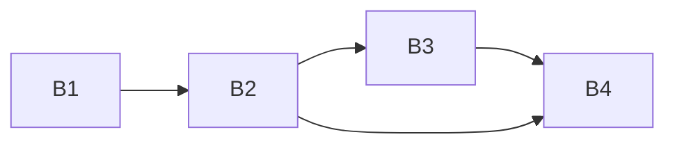

# eval-core-20261020

Project B of 4 (B eval-core, C eval-tofueval, D eval-ui, A taxonomy-v1): black-box eval framework in root `eval/`, plus the `run_info` contract bump it needs. Build order across all projects: B1 -> B2 -> B3 -> B4 -> C1 -> C2 -> D1 -> D2 -> A1.

## Sub-projects
| Sub-project | PRD | Scope | Depends on | Status |
|---|---|---|---|---|
| B1 Contract run_info | [PRD](01-contract-run-info/PRD.md) | Optional `run_info` (models, prompt hashes; optional tokens/`cost_usd` declared but not populated by the backend) in AuditResponse; shared contract 1.1.0 across backend, frontend, validators, docs; ADR 0014 | none | merged (done) |
| B2 Eval engine | [PRD](02-eval-engine/PRD.md) | `eval/` project: dataset adapter protocol and metadata keys, selection, HTTP client with schema validation, crash-safe run store, resume, optional cost cap, probe, download framework, synthetic dataset | B1 | done |
| B3 Metrics & scoring | [PRD](03-metrics-scoring/PRD.md) | Metrics registry, failure policy, clustered bootstrap CIs, `metrics.json`/`compare.json`/`item_rows.json`, compare on shared items | B2 | done |
| B4 Eval API + dev script | [PRD](04-eval-api-devscript/PRD.md) | Local FastAPI server (127.0.0.1:8100), `eval-api.schema.json` (bundles B3 schemas), `scripts/dev.sh` | B2, B3 | done |

Brief: [brainstorming.md](brainstorming.md).

## Dependency graph

## Locked decisions
- Backend does no token accounting or pricing (no `pricing.py`); `tokens` and `cost_usd` are optional contract fields consumers show only if present; no fake zeros.
- `max_cost_usd` optional in the start-run request (unset = no cap); cap set + response lacks `cost_usd` = run fails (fail closed).
- Audit deadline 100 s is canonical (ADR 0008 corrected in B2).
- `leakage.toml` is extended to scan root `eval/data` in C1; `eval/` tests are not added to PR CI; concurrency 4 accepted.
- Contract 1.2.0 bump: saved 1.1.0 items will not open in the frontend; accepted, no compat work.
- One shared contract version; a bump moves backend, frontend and validators together.
- Eval never imports `iaudit_backend`; schemas read from `docs/contracts/`.
- Item ids are filename-safe (`[A-Za-z0-9._-]{1,128}`); stored states `running|finished|aborted_cost|aborted|failed`, `interrupted` derived.
- Run tags (contamination) only via optional `tags` in the start-run request, default unset; no UI field in v1.
- Metrics schemas live in `eval/schemas/`, API schema in `eval/api/`; B4 bundles the B3 schemas.
- One run at a time; polling, no push; no CLI.

## Open questions and risks (after reconciliation)
- [RESOLVED: moot, no backend cost, owner decision 2026-10-20] LiteLLM cache tokens vs `cost_usd` formula (B1).
- [RESOLVED: 100 s canonical; ADR 0008 updated in B2, owner decision 2026-10-20] Audit deadline.
- [RESOLVED: not added, owner decision 2026-10-20] `eval/` unit tests in PR CI (B2).
- [RESOLVED: C1 extends `leakage.toml` to root `eval/data`, owner decision 2026-10-20] Leakage scan coverage (B2, C1, A1).
- [RESOLVED: fail closed, no `require_cost`, owner decision 2026-10-20] Missing `cost_usd` with a cap set (B2).
- [RESOLVED: 4 accepted, owner decision 2026-10-20] Concurrency vs backend rate limits (B2).
- [DEFERRED] Shared hash code between backend and `backend/eval` (B1); non-label gold, cross-run significance (B3); item-list pagination UI, two-server lockfile (B4).

## Manual (owner) steps
- [RESOLVED: no `pricing.py`, owner decision 2026-10-20] Confirm price numbers (B1).
- Agents run offline only: no live LLM/provider calls, no real backend with keys, no real dataset downloads, no live smoke (owner decision 2026-10-20). Agents build code, schemas, fake/stub backends, fixtures, offline tests, docs and `scripts/dev.sh`; the owner runs everything live. `python -m eval.run --mode oracle --gate poc` is offline fixture-based and stays agent-run.
- Owner manual check: first live smoke of `scripts/dev.sh` (backend + eval server + frontend, Ctrl-C leaves no orphans, `--stub`) with provider API keys in the environment (B4).
- Owner manual check: real dataset download via the download framework, then a small live pilot run against the real backend; results appear in the UI (B2, B4).
- Owner manual check: ADR 0013 replay against live recordings, if/when recordings exist (B1).
- [RESOLVED: verified, `app.py` ~line 175 checks `schema_version` before schema validation] Backend request-version check order (zero-spend probe, B2).

## Implementation and review

B1's six tasks merged in [PR #28](https://github.com/Onolys/iaudit/pull/28); all 30 B2–B4
tasks are done. Consolidated [code run](../feat-eval-core-b2-b4-20261021-0607/code-2026-10-21-0607.md) and
[review PASS](../feat-eval-core-b2-b4-20261021-0607/review-2026-10-21-0607.md) record verified source head `e33f1b0`,
503 offline eval tests and the unchanged owner-only manual checks below the plans.
Generated [integration notes](../feat-eval-core-b2-b4-20261021-0607/INTEGRATION.md) live in the branch artifact folder.
C, D and A are not implemented by this branch.
