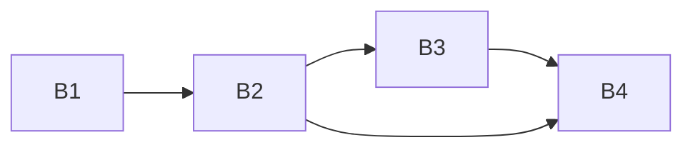

# eval-core-20261020

Project B of 4 (B eval-core, C eval-tofueval, D eval-ui, A taxonomy-v1): black-box eval framework in root `eval/`, plus the `run_info` contract bump it needs. Build order across all projects: B1 -> B2 -> B3 -> B4 -> C1 -> C2 -> D1 -> D2 -> A1.

## Sub-projects
| Sub-project | PRD | Scope | Depends on | Status |
|---|---|---|---|---|
| B1 Contract run_info | [PRD](01-contract-run-info/PRD.md) | Optional `run_info` (models, prompt hashes, tokens, optional `cost_usd`) in AuditResponse; shared contract 1.1.0 across backend, frontend, validators, docs; ADR 0014 | none | draft |
| B2 Eval engine | [PRD](02-eval-engine/PRD.md) | `eval/` project: dataset adapter protocol and metadata keys, selection, HTTP client with schema validation, crash-safe run store, resume, cost cap, probe, download framework, synthetic dataset | B1 | draft |
| B3 Metrics & scoring | [PRD](03-metrics-scoring/PRD.md) | Metrics registry, failure policy, clustered bootstrap CIs, `metrics.json`/`compare.json`/`item_rows.json`, compare on shared items | B2 | draft |
| B4 Eval API + dev script | [PRD](04-eval-api-devscript/PRD.md) | Local FastAPI server (127.0.0.1:8100), `eval-api.schema.json` (bundles B3 schemas), `scripts/dev.sh` | B2, B3 | draft |

Brief: [brainstorming.md](brainstorming.md).

## Dependency graph

## Locked decisions
- `cost_usd` optional in `run_info`, omitted when the backend has no price; no fake zeros.
- One shared contract version; a bump moves backend, frontend and validators together.
- Eval never imports `iaudit_backend`; schemas read from `docs/contracts/`.
- Item ids are filename-safe (`[A-Za-z0-9._-]{1,128}`); stored states `running|finished|aborted_cost|aborted|failed`, `interrupted` derived.
- Run tags (contamination) only via optional `tags` in the start-run request, default unset; no UI field in v1.
- Metrics schemas live in `eval/schemas/`, API schema in `eval/api/`; B4 bundles the B3 schemas.
- One run at a time; polling, no push; no CLI.

## Open questions and risks (after reconciliation)
- [OPEN] LiteLLM `prompt_tokens` may already include cache tokens: blocks the `cost_usd` formula (B1).
- [OPEN] Audit deadline: ADR 0008 says 60 s, `config.py` `audit_deadline_s` is 100 s (B2); owner picks canonical.
- [OPEN] Add `eval/` unit tests to PR CI? (B2)
- [OPEN] `leakage.toml` does not cover root `eval/data` (B2, C1, A1).
- [OPEN] Missing `cost_usd` makes the max-cost cap unenforceable; add fail-closed `require_cost`? (B2)
- [OPEN] Concurrency 4 vs backend rate limits untested live (B2).
- [DEFERRED] Shared hash/price code between backend and `backend/eval`; per-attempt token accounting (B1); non-label gold, cross-run significance (B3); item-list pagination UI, two-server lockfile (B4).

## Manual (owner) steps
- Confirm price numbers in `backend/src/iaudit_backend/pricing.py` (B1).
- First live smoke of `scripts/dev.sh` with provider API keys in the environment (B4).
- Re-check the backend checks the request version before the schema (needed by the zero-spend probe, B2).
