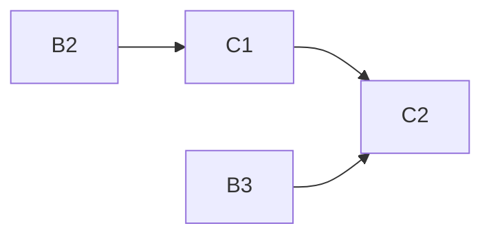

# eval-tofueval-20261020

Project C of 4: TofuEval dataset plug-in for the eval framework (sentence- and summary-level consistency, 1,777 summary items).

## Sub-projects
| Sub-project | PRD | Scope | Depends on | Status |
|---|---|---|---|---|
| C1 Data & items | [PRD](01-data-and-items/PRD.md) | Pinned download + hashes, 1,777 items, transcript-to-turns, assessment with verified sentence offsets, schema-valid requests | B2 (adapter protocol, download hook), B4 (Download button) | complete |
| C2 Projection & metrics | [PRD](02-projection-and-metrics/PRD.md) | Gold + claim-to-sentence projection, frozen `mapping.json` v1.0.0, metric aliases and slices, paper references, `item_row`, integrity block | C1, B3, B1 | in-progress |

Brief: [brainstorming.md](brainstorming.md).

## Dependency graph

## Locked decisions
- Item id `{dataset}--{doc_slug}--{topic_slug}--{model_slug}`; ids >128 chars shortened deterministically with a hash suffix (fixture-tested); `request_id` set by the engine.
- No role/speaker/timestamp inference; generic MediaSum labels kept as-is, same label = one speaker; MeetingBank blob split into <=60-word turns, frozen at `adapter_version`.
- `mapping.json` v1.0.0 is frozen; A1 leaves it untouched; any later change is a separately versioned decision.
- Unresolved sentences count wrong in primary, excluded in secondary; original-five and Model-Extra are never pooled (`pool_all: false`).
- `gold_kind` is `tofueval_summary_sentences`; gold text/`exp` are never persisted (`exp` on-demand only).
- Metric `concern_match_given_detected` x 5 added (C2).
- MediaSum: `ccdv/mediasum` assumed identical to original `news_dialogue.json` (owner accepted); no equality check.
- Owner runs all real downloads and live audits/evals manually; agents build code only, no real data or live calls.
- Audit deadline 100 s (`config.py`) is canonical; ADR 0008 fixed in B2.
- C1 extends `backend/eval/leakage.toml` to scan root `eval/data` (`test_prompt_leakage` skips when data absent).
- A claim overlapping two summary sentences flags both (accepted).
- Backend computes no tokens/cost; `cost_usd` shown only if present. Concurrency 4 accepted.
- Saved 1.1.0 items do not open in the item view after the 1.2.0 contract bump (accepted).
- Test-run count is informational only; contamination tag is run-level via start-run `tags`.

## Open questions and risks (after reconciliation)
- [RESOLVED] All former open items resolved by owner decisions 2026-10-20: paper segment lengths (note only), MediaSum `ccdv/mediasum` assumption, generic speaker labels (as-is), item-id length guard, `concern_match_given_detected` (added), `exp` on-demand only.
- [DEFERRED] Long transcripts may still hit the 100 s deadline; checked by the owner's first 5-item pilot run (C1).
- [DEFERRED] MeetingBank source equality vs annotated text (owner, C1); `concern_not_in_mapping` evidence for a future mapping decision; wide per-type CIs (C2).

## Manual (owner) steps
- Owner runs everything live; agents download no real data and run no live audits/evals.
- Verify MeetingBank source equality [DEFERRED]; review `manifest.json` after the first UI download and commit `expected_sha256`; accept MediaSum and MeetingBank licenses (C1).
- Run the real-data smoke (1,777 items, schema-valid, offsets) and the 5-item pilot run; check results in the UI and long-transcript vs 100 s deadline (C1).
- Set `tags.contamination` per run via the start-run request; optionally eyeball Table 3 on PDF p.7 (C2).
