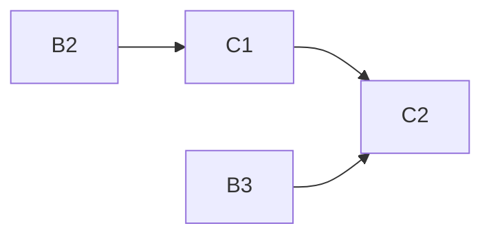

# eval-tofueval-20261020

Project C of 4: TofuEval dataset plug-in for the eval framework (sentence- and summary-level consistency, 1,777 summary items).

## Sub-projects
| Sub-project | PRD | Scope | Depends on | Status |
|---|---|---|---|---|
| C1 Data & items | [PRD](01-data-and-items/PRD.md) | Pinned download + hashes, 1,777 items, transcript-to-turns, assessment with verified sentence offsets, schema-valid requests | B2 (adapter protocol, download hook), B4 (Download button) | draft |
| C2 Projection & metrics | [PRD](02-projection-and-metrics/PRD.md) | Gold + claim-to-sentence projection, frozen `mapping.json` v1.0.0, metric aliases and slices, paper references, `item_row`, integrity block | C1, B3, B1 | draft |

Brief: [brainstorming.md](brainstorming.md).

## Dependency graph

## Locked decisions
- Item id `{dataset}--{doc_slug}--{topic_slug}--{model_slug}`; `request_id` set by the engine.
- No role/speaker/timestamp inference; MeetingBank blob split into <=60-word turns, frozen at `adapter_version`.
- `mapping.json` v1.0.0 is frozen; A1 leaves it untouched; any later change is a separately versioned decision.
- Unresolved sentences count wrong in primary, excluded in secondary; original-five and Model-Extra are never pooled (`pool_all: false`).
- `gold_kind` is `tofueval_summary_sentences`; gold text/`exp` are never persisted.
- Test-run count is informational only; contamination tag is run-level via start-run `tags`.

## Open questions and risks (after reconciliation)
- [OPEN] Paper segment lengths (970/930) vs measured 778/752 words: token-count explanation untested (C1).
- [OPEN] MediaSum `ccdv/mediasum` vs original `news_dialogue.json` equality (C1).
- [OPEN] Audit deadline 60 s (ADR 0008) vs 100 s (`config.py`) vs long transcripts (C1, see B2).
- [OPEN] Generic MediaSum speaker labels ("Unidentified Male") pass through (C1).
- [OPEN] `leakage.toml` coverage of `eval/data/tofueval` (C1).
- [OPEN] Max item-id length after slugging not yet measured against the 128 limit (C1).
- [OPEN] Add `concern_match_given_detected`? Rule 1 may over-flag neighbours; `exp` persistence assumed on-demand only (C2).
- [DEFERRED] MeetingBank source equality vs annotated text (owner, C1); `concern_not_in_mapping` evidence for a future mapping decision; wide per-type CIs (C2).

## Manual (owner) steps
- Verify MeetingBank (and spot-check MediaSum) source equality [DEFERRED]; review `manifest.json` after the first UI download and commit `expected_sha256`; accept MediaSum and MeetingBank licenses (C1).
- Set `tags.contamination` per run via the start-run request; optionally eyeball Table 3 on PDF p.7 (C2).
