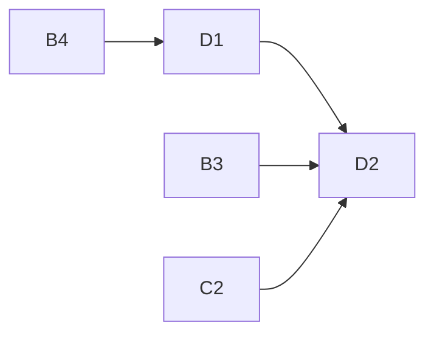

# eval-ui-20261020

Project D of 4: Eval tab in the existing frontend for running and reviewing evals.

## Sub-projects
| Sub-project | PRD | Scope | Depends on | Status |
|---|---|---|---|---|
| D1 Eval shell & runs | [PRD](01-eval-shell-and-runs/PRD.md) | Audit/Eval toggle, `evalApi`, `usePolling`, run form (estimate, download, progress, abort), runs list (resume, compare pick), Vite `/eval-api` proxy, `docs/reference/eval-ui.md` | B4 (and B1 frontend 1.1.0 validators) | draft |
| D2 Results & items | [PRD](02-results-and-items/PRD.md) | Run detail (metrics, paper rows, re-score, run info), item list, read-only item replay in `ReviewShell` + GoldPanel, failed items, two-run compare | D1, B3, B4, C2 | draft |

Brief: [brainstorming.md](brainstorming.md).

## Dependency graph

## Locked decisions
- Plain tables, no charts, no router; polling ~1 s; one run at a time.
- All server access via one never-throwing `evalApi`; types hand-mirrored and Ajv-checked against `eval-api.schema.json`.
- Item view replays saved data through the existing validators; `ReviewShell`, `LeftPane`, `RightPane`, `reviewState` untouched.
- `cost_usd` optional: UI shows "unknown" and warns when `cost_known=false`.
- Contamination tag: no UI field in v1.
- D1 creates `docs/reference/eval-ui.md`; D2 appends.

## Open questions and risks (after reconciliation)
- [OPEN] `max_cost_usd` is required but unenforceable when responses lack `cost_usd`; fail-closed option is a user call (D1, B2).
- [OPEN] After A1 moves the contract to 1.2.0, saved 1.1.0 items (incl. the pre-A1 baseline) fail the item view's version pin (D2, A1).
- [DEFERRED] Item-list pagination/sort, next/previous item, concurrency/seed fields, ours-per-sentence in GoldPanel, production proxy.

## Manual (owner) steps
- Live smoke with `scripts/dev.sh` and provider keys: pilot run, close and reopen the tab mid-run (D1).
- Eyeball one real TofuEval item against the source after download (D2).
