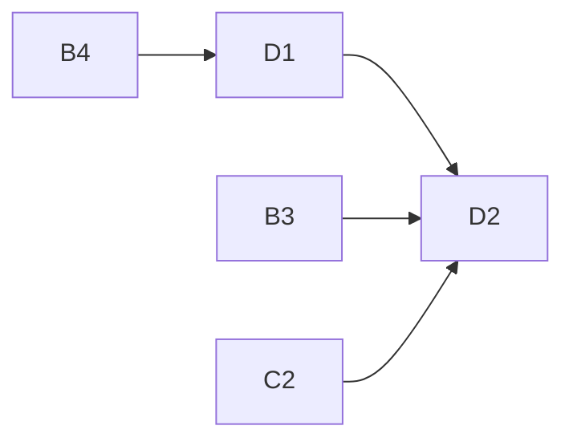

# eval-ui-20261020

Project D of 4: Eval tab in the existing frontend for running and reviewing evals.

## Sub-projects
| Sub-project | PRD | Scope | Depends on | Status |
|---|---|---|---|---|
| D1 Eval shell & runs | [PRD](01-eval-shell-and-runs/PRD.md) | Audit/Eval toggle, `evalApi`, `usePolling`, run form (estimate, download, progress, abort), runs list (resume, compare pick), Vite `/eval-api` proxy, `docs/reference/eval-ui.md` | B4 (and B1 frontend 1.1.0 validators) | complete offline |
| D2 Results & items | [PRD](02-results-and-items/PRD.md) | Run detail (metrics, paper rows, re-score, run info), item list, read-only item replay in `ReviewShell` + GoldPanel, failed items, two-run compare | D1, B3, B4, C2 | complete offline |

Brief: [brainstorming.md](brainstorming.md).

All ten D1 and eleven D2 tasks are implemented and verified offline. The fourteen
tasks deferred at the earlier checkpoint are now complete; final independent review
is PASS from all three personas after the scoring/item-refresh correction. Execution evidence: [final code run](../feat-eval-tofueval-ui-20261021/code-final-project-d-2026-10-21.md).
Owner checks below remain deferred.

## Dependency graph

## Locked decisions
- Plain tables, no charts, no router; polling ~1 s; one run at a time.
- All server access via one never-throwing `evalApi`; types hand-mirrored and Ajv-checked against `eval-api.schema.json`.
- Item view replays saved data through the existing validators; `ReviewShell`, `LeftPane`, `RightPane`, `reviewState` untouched.
- Backend computes no tokens/cost; `tokens`/`cost_usd` optional, UI shows them only if present (else "unknown"), no `cost_known` warning.
- `max_cost_usd` optional (blank = no cap); set cap + missing `cost_usd` fails the run (fail closed), surfaced as a failed run.
- Item view rejecting items saved under older contract versions (1.1.0 after A1) is accepted; no replay compat.
- Eval concurrency 4; no CI for eval.
- Contamination tag: no UI field in v1.
- D1 creates `docs/reference/eval-ui.md`; D2 appends.

## Open questions and risks (after reconciliation)
- [RESOLVED: owner decision 2026-10-20] `max_cost_usd` optional, fail closed when cap set and cost missing (D1, B2).
- [RESOLVED: owner decision 2026-10-20] Saved 1.1.0 items fail the item view's pin after A1; accepted (D2, A1).
- [DEFERRED] Item-list pagination/sort, next/previous item, concurrency/seed fields, ours-per-sentence in GoldPanel, production proxy.

## Manual (owner) steps
- Agents run offline only: no live LLM/provider calls, no real backend with keys, no real dataset downloads, no live smoke, no real-browser checks (owner decision 2026-10-20). Fake-fetch/stub-server tests and fixtures stay agent-run.
- Owner manual check: live smoke with `scripts/dev.sh` and provider keys: pilot run, close and reopen the tab in a real browser mid-run, confirm it re-attaches and the run keeps going (D1).
- Owner manual check: `/eval-api/health` through the running Vite dev server reaches the real eval server (D1).
- Owner manual check: eyeball one real TofuEval item against the source after download; also confirm run detail, item replay and compare render with real run results in the UI (D2).
- Final end-to-end test only after all changes land (owner; includes the pre-A1 baseline item view caveat).
