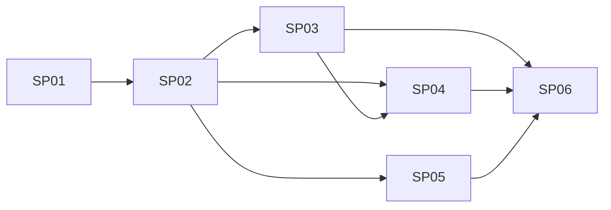

# Review UI v1 — PRD index

Read-only React + TS + Vite viewer (`frontend/`) over the audit contract in `docs/contracts/`: upload a request, show the audit beside the text. Source: [brainstorming.md](../ab-20261010-221456-a271e3e2/brainstorming.md). Governing scope: `docs/mission.md`.

## Sub-projects
| # | Sub-project | Phase | Depends on | Owns | PRD | Status |
|---|---|---|---|---|---|---|
| 01 | Frontend scaffold | 0 | none | `frontend/` config, `src/config.ts`, `src/tokens/` | [PRD](01-frontend-scaffold/PRD.md) | draft |
| 02 | Contract core | 1 | 01 | `src/contract/` (types, Ajv, bounds, spans, counts, excerpts) | [PRD](02-contract-core/PRD.md) | draft |
| 03 | Transport, mock, errors | 2 | 01, 02 | `src/transport/` (loader, client, mock registry, error screens, banner) | [PRD](03-transport-mock-errors/PRD.md) | draft |
| 04 | Review shell + left pane | 2 | 01, 02, 03 | `src/app/` (App, header, state, left pane, NavStepper) | [PRD](04-review-shell-left-pane/PRD.md) | draft |
| 05 | Claim detail (right pane) | 2 | 01, 02 | `src/claim-detail/` | [PRD](05-claim-detail-right-pane/PRD.md) | draft |
| 06 | Fixtures + hardening | 3 | 02, 03, 04, 05 | extra `docs/contracts/examples/` pairs, palette values, e2e + fixture tests, `docs/testing/review-ui.md` | [PRD](06-fixtures-hardening/PRD.md) | draft |

## Dependency graph

03, 04, 05 can run in parallel after 02 except 04 consumes 03's loader and 05's `ClaimDetail` (stub until 05 lands).

## Locked decisions
- Read-only viewer; no auth, accept/dismiss, export, filters, expand-all, keyboard shortcuts, mobile. No contract changes; `schema_version` stays `1.0.0`.
- One request-file upload; UI POSTs it to `VITE_AUDIT_URL`. `VITE_MOCK === "true"` (exact) serves bundled examples.
- Schemas imported in place via `@contracts` alias (-> `docs/contracts`); never copied. TS 7: no `baseUrl`.
- Ajv: `ajv/dist/2020`, `allErrors`, `allowUnionTypes: true`, `strictTypes: false`; `strict: true` throws on the response schema.
- Types hand-written + enum drift test against schema enums. `Verdict`/`EvidenceRole` unions defined in SP01 tokens, re-exported by SP02.
- Offsets are Unicode code points; all quoted text comes from `sliceCodePoints`/`walkSpan`, never `String.slice`. No grapheme handling.
- Bad span flags that claim only (`spanOutOfRange`); duplicate claim ids / wrong version / request_id mismatch reject the whole response. Dangling refs tolerated.
- Mock naming `<name>.request.json` + `<name>.response.json`; bare `request.json`/`response.json` = `default`. Match by `request_id`, else deep-equal; no match -> `mock_no_match` error. Lazy `import.meta.glob`.
- Timeout 120 s default (`DEFAULT_TIMEOUT_MS`); cancel/retry; generation guard drops stale responses; `credentials: 'omit'`; no logging/storage of bodies.
- Transport returns `{ok, request, response, analysis, source}` (`analysis` = SP02 `ResponseAnalysis`, replaces `spanIssues`).
- `ClaimDetail({claim, request, check: ClaimCheck})`; `check = analysis.checks[claim.id]`.
- Every claim underlined in verdict style (solid/dashed insufficient/dotted out-of-scope); colour + icon + label always; neutral background on selection; first claim (document order) selected on load.
- Counts are navigation (`‹ n of N ›`, clamp, zero = disabled); left pane is the single scroll container with sticky card headers; new upload discards old audit.
- Right pane order: verdict, explanation, suggestion ("Suggestion — not applied"), concerns, excerpts in transcript order; +3 turns per click, merging chunks (`buildChunks`), no turn shown twice.
- Fixtures fictional, in `docs/contracts/examples/`; `out-of-range` is the only deliberately non-conforming pair.

## Interface reconciliations (cross-PRD pass, 2026-10-10)
- SP04 now passes `check={analysis.checks[claim.id]}` to `ClaimDetail` (was `spanOutOfRange`); SP02 consumers note, SP04 R5/R6/Architecture/Acceptance updated. SP05 [OPEN] items on this closed.
- SP04 `notProcessedSections` now written as `notProcessedSections(response)` (matches SP02 R6).
- SP04 `ReviewShell key={loadId}`: SP03 `LoaderState` has no id; SP04 uses an App-local counter.
- SP02 R1: `Verdict`/`EvidenceRole` come from SP01 tokens (SP01 D8), not defined fresh in SP02.
- Verified consistent, no change: SP03 `analysis` field vs SP04 usage; SP04 `segmentSection(request, i, analysis.checks)`, `claimIdsFor`, `validate*`, `analyzeResponse`; SP06 mock naming/matching vs SP03 R4; SP05 `walkSpan`/`buildChunks` usage.
- Gaps SP02 does not define -> new SP02 [OPEN] item (O-02-6).

## Risks / open questions (all [OPEN])
| ID | Item | PRD | Blocks? |
|---|---|---|---|
| O-01-1 | ESLint config flavour (flat + typescript-eslint assumed) | 01 | no, confirm at impl |
| O-01-2 | `VITE_AUDIT_URL` fixed per build (build-time inlining) acceptable? | 01 | no, human call |
| O-02-1 | Shared-turn, two roles: painting undecided in SP02 (SP05 D4 proposes a design) | 02 | no |
| O-02-2 | Lone surrogates: JS vs Python offsets may disagree; confirm with backend | 02 | no, backend call |
| O-02-3 | ZWJ/combining: span may cut mid-grapheme; confirm acceptable | 02 | no, human call |
| O-02-4 | Friendlier wording for Ajv `contains`/`minContains` messages | 02 | no |
| O-02-5 | Perf ceiling for very long transcripts (measure on SP06 `long`) | 02 | no |
| O-02-6 | Interface gaps: `orderedClaims` element type; `notProcessed` field vs `notProcessedSections()`; `ClaimCheck.evidence` key; `orderEvidence` 3rd arg (`check` vs `checks`); `analysis.checks` not in R3/R6 | 02 | yes, SP03/04/05 tasks |
| O-03-1 | Endpoint path and CORS (incl. OPTIONS) not agreed; no backend | 03 | no (mock covers); blocks real integration |
| O-03-2 | 120 s timeout is a guess; measure; `VITE_AUDIT_TIMEOUT_MS` deferred | 03 | no |
| O-03-3 | 4xx/5xx error-body shape unknown (R5 heuristic) | 03 | no |
| O-03-4 | `import.meta.glob` with `@contracts` alias unverified; relative fallback defined | 03 | no, verify first |
| O-03-5 | Extra fixtures vs contract README "one worked example" wording (handled in SP06 R2) | 03 | no |
| O-04-1 | Narrow-desktop header: wrap at ~1100 px, min width 960 px (provisional) | 04 | no, human call |
| O-04-2 | Verdict superscript icons may be noisy on long text; judge on SP06 `long` | 04 | no |
| O-04-3 | Pane width ratio and underline thickness (SP06 visual pass) | 04 | no |
| O-04-4 | Assumed SP02 shapes (`orderedClaims`, `checks`, unplaced detection); partly covered by O-02-6 | 04 | with O-02-6 |
| O-05-1 | Shared-turn painting (D4) is on paper; confirm at SP06 two-role fixture | 05 | no |
| O-05-2 | Turn number base: 0-based `#index` vs 1-based; confirm with user | 05 | no, human call |
| O-05-3 | Very long single turns make excerpts tall; no truncation planned | 05 | no |
| O-06-1 | `culori` colour-deficiency filters approximate; acceptable as gate? | 06 | no, human call |
| O-06-2 | Builder script location (`frontend/` vs `docs/contracts/`) | 06 | no |
| O-06-3 | Palette finals depend on the check; hex values are candidates | 06 | no |
| O-06-4 | ZWJ/lone-surrogate Python vs JS behaviour (lone surrogates not fixtured) | 06 | no |

IDs are index-only labels added here; the PRDs carry the original [OPEN] tags.

## Next step
Human resolves the [OPEN] items in each PRD (at least O-02-6, which gates 03/04/05), flips PRD status, then runs `dev-tasks` for each PRD.
