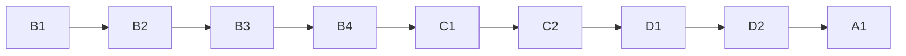

# taxonomy-v1-20261020

Project A of 4, built last so the eval gives a clean "before" measurement.

## Sub-projects
| Sub-project | PRD | Scope | Depends on | Status |
|---|---|---|---|---|
| A1 Taxonomy v1 | [PRD](01-taxonomy-v1/PRD.md) | `quantity_mismatch` as mission check 13 (13th enum value), widened `wrong_attribution` and `context_stripping`, two labelling rules, mission amendment, contract 1.2.0, ADR 0015, TofuEval dev before/after | B1-B4, C1-C2, D1-D2 | draft |

Brief: [brainstorming.md](brainstorming.md).

## Dependency graph

## Locked decisions
- Mission amended to allow arithmetic in `quantity_mismatch`; score/rubric arithmetic stays excluded; owner approves final wording first.
- Appended last in the enum so buckets 1-12 and ADHD gold stay put; LLM observes, code guards and decides.
- Contract 1.2.0 moves backend, frontend and validators together; ADR 0015 (B1 owns 0014).
- `mapping.json` v1.0.0 untouched for the before/after; any future mapping change is a separate versioned decision.
- Faithful rounding incl. dropped decimals ("$10.6B" as "$10B") is not a mismatch; tweak later on dev.
- Contradiction concern-match drop accepted as a labelled known side effect; no secondary mapping file.
- `leakage.toml` extended to root `eval/data` (incl. tofueval) by eval-tofueval C1; A1 still runs `test_prompt_leakage`.
- 1.2.0 breaking replay of saved 1.1.0 items (incl. pre-A1 baseline) accepted.
- Audit deadline 100 s (`config.py`) canonical; backend does not compute tokens/cost.
- No tuning on the TofuEval test split; no benchmark text in prompts or fixtures.

## Open questions and risks (after reconciliation)
- [DEFERRED: owner measures in manual runs] Widened definitions may raise false positives; owner compares ADHD bucket 3 and 8 precision before/after.
- [DEFERRED: owner measures in manual runs] Prompt growth vs the 100 s audit deadline (`config.py`, canonical; ADR 0008 corrected in eval-core B2): owner checks p95 latency.
- [DEFERRED] Deterministic numeric comparison in code; rename `other_person`; broaden `unsupported_causal_link`; evidence-based escalation to contradicted.

## Manual (owner) steps
- Approve final mission wording before implementation; confirm ADR wording/number.
- Record the TofuEval dev baseline before A1 prompt changes merge.
- Run the after pass.
- Run the test split once, at the end.
- Final end-to-end test (incl. saved-item replay) after all changes.
- Owner runs everything live manually; agents build prompts, schema, code, fixtures, scripted tests, docs, and run only offline checks (pytest, ruff, oracle gate, npm typecheck/test).
