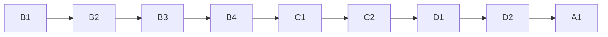

# taxonomy-v1-20261020

Project A of 4, built last so the eval gives a clean "before" measurement.

## Sub-projects
| Sub-project | PRD | Scope | Depends on | Status |
|---|---|---|---|---|
| A1 Taxonomy v1 | [PRD](01-taxonomy-v1/PRD.md) | `quantity_mismatch` as mission check 13 (13th enum value), widened `wrong_attribution` and `context_stripping`, two labelling rules, mission amendment, contract 1.2.0, ADR 0015, TofuEval dev before/after | B1-B4, C1-C2, D1-D2 | draft |

Brief: [brainstorming.md](brainstorming.md).

## Dependency graph

## Locked decisions
- Mission amended to allow arithmetic in `quantity_mismatch`; score/rubric arithmetic stays excluded; owner approves final wording first.
- Appended last in the enum so buckets 1-12 and ADHD gold stay put; LLM observes, code guards and decides.
- Contract 1.2.0 moves backend, frontend and validators together; ADR 0015 (B1 owns 0014).
- `mapping.json` v1.0.0 untouched for the before/after; any future mapping change is a separate versioned decision.
- No tuning on the TofuEval test split; no benchmark text in prompts or fixtures.

## Open questions and risks (after reconciliation)
- [OPEN] Rounding threshold ("$10.6B" vs "$10B"); tune on dev only.
- [OPEN] `leakage.toml` coverage of `eval/data/tofueval`.
- [OPEN] Is the concern-match drop in Contradiction acceptable as a labelled artifact vs a secondary mapping file?
- [OPEN] Widened definitions may raise false positives (check ADHD buckets 3 and 8).
- [OPEN] Prompt growth vs the audit deadline (ADR 0008 60 s vs `config.py` 100 s, see eval-core B2).
- [OPEN] 1.2.0 breaks item-view replay of the pre-A1 baseline run (see eval-ui D2).
- [DEFERRED] Deterministic numeric comparison in code; rename `other_person`; broaden `unsupported_causal_link`; evidence-based escalation to contradicted.

## Manual (owner) steps
- Approve final mission wording before implementation; confirm ADR wording/number.
- Record the TofuEval dev baseline before A1 prompt changes merge; run the after pass; test split once at the end.
